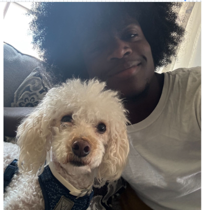

# Zaire Robinson

## About me

I am a senior student in **SUNY New Paltz**. Outside of school i like to *write*, *game*, and *watch movies*. I hope to create stories in the future for others to enjoy. 



## Technical Background

I have been practicing and learning programming for 4 or 5 years now. In recent days im tring to work on personal projects to build my resume. Reasources like [GeeksForGeeks](https://www.geeksforgeeks.org/) are useful for learning things outside of class. My most used language is java.

```java
boolean isStoreOpen = true;

if (isStoreOpen) {
    System.out.println("Welcome to the market!");
} else {
    System.out.println("Sorry, we are closed.");
}
```


### skills:
- Java
- Python 
- Code Analysis
- ~~Mathematics~~

## Goals

### personal:
1. Finish school
1. Get a well paying job
1. Build wealth

### Computer Science
1. Create helpful [personal projects](https://github.com/PhoenixTJM)
1. Create a game from scratch
1. Create animations

## Motto
> You can only get the vaccine from the virus

This means you can only get better at something from doing that task. It applies to programming because it's one of those skills you don't improve on without practice.

## Semester plans
- [x] Understand html
- [ ] Learn about making websites
- [ ] Learning about hosting
- [ ] Create my own websites